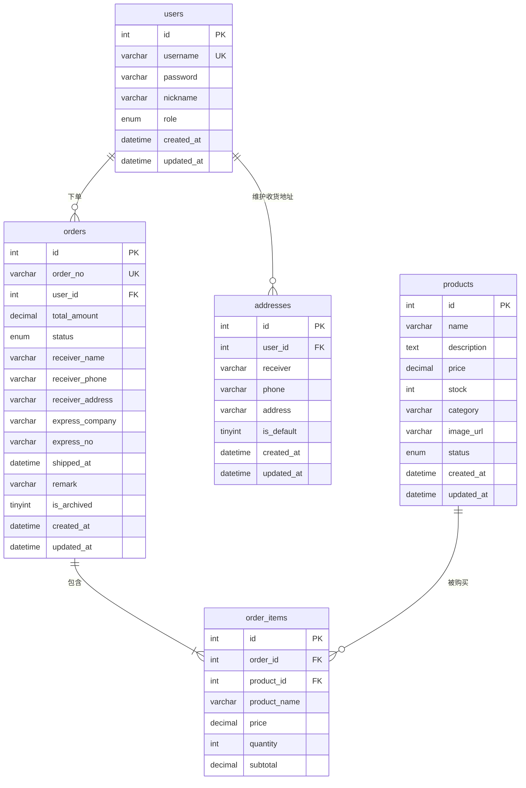

# 简易电商平台 — 数据库设计文档

> 项目：简易电商后台（全栈项目开发前后端实训 · 选题 D）
> 版本：v1.1 ｜ 日期：2026-11-11 ｜ 数据库：MySQL 8.0+

## 1. 设计概述

本系统采用 MySQL 关系型数据库，共设计 **5 张核心表**：

| 表名 | 说明 | 归属 |
|---|---|---|
| `users` | 用户表（含管理员 / 普通用户角色） | 用户权限模块 |
| `products` | 商品表（含上架 / 下架状态、库存） | 商品管理模块 |
| `orders` | 订单表（含状态流转） | 订单管理模块 |
| `order_items` | 订单明细表（商品快照） | 订单管理模块 |
| `addresses` | 收货地址簿表（用户收货地址，支持默认地址） | 用户权限模块 |

设计要点：
- 所有表使用 `utf8mb4` 字符集，支持中文与 Emoji；
- 主键统一为自增 `INT`；时间字段统一 `DATETIME`，由数据库默认值维护 `created_at`；
- 订单明细保存**商品名称与单价快照**，避免商品改价 / 删除后历史订单数据失真；
- 密码只存 bcrypt 哈希，绝不存明文。

## 2. ER 图

## 3. 表结构说明

### 3.1 users（用户表）

| 字段 | 类型 | 约束 | 说明 |
|---|---|---|---|
| id | INT | PK, AUTO_INCREMENT | 用户ID |
| username | VARCHAR(50) | NOT NULL, UNIQUE | 登录用户名 |
| password | VARCHAR(255) | NOT NULL | bcrypt 哈希密码 |
| nickname | VARCHAR(50) | NULL | 昵称（展示用） |
| role | ENUM('admin','user') | NOT NULL, DEFAULT 'user' | 角色：admin 管理员 / user 普通用户 |
| created_at | DATETIME | NOT NULL, DEFAULT CURRENT_TIMESTAMP | 创建时间 |
| updated_at | DATETIME | NOT NULL, DEFAULT CURRENT_TIMESTAMP ON UPDATE CURRENT_TIMESTAMP | 更新时间 |

### 3.2 products（商品表）

| 字段 | 类型 | 约束 | 说明 |
|---|---|---|---|
| id | INT | PK, AUTO_INCREMENT | 商品ID |
| name | VARCHAR(100) | NOT NULL | 商品名称 |
| description | TEXT | NULL | 商品描述 |
| price | DECIMAL(10,2) | NOT NULL, DEFAULT 0.00 | 单价（元） |
| stock | INT | NOT NULL, DEFAULT 0, CHECK(stock>=0) | 库存数量 |
| category | VARCHAR(50) | NOT NULL, DEFAULT '其他' | 分类 |
| image_url | VARCHAR(255) | NULL | 图片地址 |
| status | ENUM('on','off') | NOT NULL, DEFAULT 'on' | 上架 on / 下架 off |
| created_at | DATETIME | NOT NULL, DEFAULT CURRENT_TIMESTAMP | 创建时间 |
| updated_at | DATETIME | NOT NULL, DEFAULT CURRENT_TIMESTAMP ON UPDATE CURRENT_TIMESTAMP | 更新时间 |

### 3.3 orders（订单表）

| 字段 | 类型 | 约束 | 说明 |
|---|---|---|---|
| id | INT | PK, AUTO_INCREMENT | 订单ID |
| order_no | VARCHAR(32) | NOT NULL, UNIQUE | 订单号（业务编号） |
| user_id | INT | NOT NULL, FK -> users.id | 下单用户 |
| total_amount | DECIMAL(10,2) | NOT NULL, DEFAULT 0.00 | 订单总金额 |
| status | ENUM('pending','paid','shipped','completed','cancelled') | NOT NULL, DEFAULT 'pending' | 订单状态：待支付/已支付/已发货/已完成/已取消 |
| receiver_name | VARCHAR(50) | NOT NULL | 收货人 |
| receiver_phone | VARCHAR(20) | NOT NULL | 收货电话 |
| receiver_address | VARCHAR(255) | NOT NULL | 收货地址 |
| express_company | VARCHAR(50) | NULL | 快递公司（发货时填写） |
| express_no | VARCHAR(64) | NULL | 物流单号（发货时填写） |
| shipped_at | DATETIME | NULL | 发货时间 |
| remark | VARCHAR(255) | NULL | 订单备注（用户下单或管理端补充） |
| is_archived | TINYINT(1) | NOT NULL, DEFAULT 0 | 归档标记：1=已归档（列表隐藏，数据保留可追溯） |
| created_at | DATETIME | NOT NULL, DEFAULT CURRENT_TIMESTAMP | 创建时间 |
| updated_at | DATETIME | NOT NULL, DEFAULT CURRENT_TIMESTAMP ON UPDATE CURRENT_TIMESTAMP | 更新时间 |

### 3.4 order_items（订单明细表）

| 字段 | 类型 | 约束 | 说明 |
|---|---|---|---|
| id | INT | PK, AUTO_INCREMENT | 明细ID |
| order_id | INT | NOT NULL, FK -> orders.id | 所属订单 |
| product_id | INT | NOT NULL, FK -> products.id | 商品ID |
| product_name | VARCHAR(100) | NOT NULL | 商品名称快照 |
| price | DECIMAL(10,2) | NOT NULL | 成交单价快照 |
| quantity | INT | NOT NULL, DEFAULT 1 | 购买数量 |
| subtotal | DECIMAL(10,2) | NOT NULL | 小计 = price × quantity |

### 3.5 addresses（收货地址簿表）

| 字段 | 类型 | 约束 | 说明 |
|---|---|---|---|
| id | INT | PK, AUTO_INCREMENT | 地址ID |
| user_id | INT | NOT NULL, FK -> users.id ON DELETE CASCADE | 所属用户 |
| receiver | VARCHAR(50) | NOT NULL | 收货人姓名 |
| phone | VARCHAR(20) | NOT NULL | 联系电话 |
| address | VARCHAR(255) | NOT NULL | 收货地址 |
| is_default | TINYINT(1) | NOT NULL, DEFAULT 0 | 是否默认地址：1=默认，同一用户仅一个 |
| created_at | DATETIME | NOT NULL, DEFAULT CURRENT_TIMESTAMP | 创建时间 |
| updated_at | DATETIME | NOT NULL, DEFAULT CURRENT_TIMESTAMP ON UPDATE CURRENT_TIMESTAMP | 更新时间 |

> 关系：`addresses.user_id` 外键指向 `users.id`，一个用户可维护多条收货地址（一对多），用户被删除时地址簿级联清理；下单时收货人 / 电话 / 地址仍以快照形式写入 `orders`，地址簿后续修改不影响历史订单。

## 4. 索引与约束设计

| 表 | 索引 / 约束 | 目的 |
|---|---|---|
| users | UNIQUE(username) | 用户名唯一，防重复注册 |
| products | INDEX idx_products_status(status) | 加速按上架状态筛选 |
| products | INDEX idx_products_category(category) | 加速按分类筛选 |
| products | CHECK(stock >= 0) | 库存不允许为负 |
| orders | UNIQUE(order_no) | 订单号业务唯一 |
| orders | INDEX idx_orders_user(user_id) | 加速按用户查订单 |
| orders | FK user_id -> users.id (fk_orders_user) | 下单用户必须存在 |
| orders | INDEX idx_orders_status(status) | 加速按状态筛选订单 |
| orders | INDEX idx_orders_archived(is_archived) | 加速按归档标记过滤订单列表 |
| orders | INDEX idx_orders_status_created(status, created_at) | 加速「状态 + 时间」组合查询与趋势统计 |
| order_items | FK order_id -> orders.id ON DELETE CASCADE | 删除订单级联删除明细 |
| addresses | FK user_id -> users.id ON DELETE CASCADE | 用户删除时级联清理地址簿 |
| addresses | INDEX idx_addresses_user(user_id) | 加速按用户查地址列表 |
| order_items | INDEX idx_order_items_product(product_id) | 加速按商品聚合统计 |

## 5. 业务约束与一致性说明

1. **库存扣减**：下单时在事务内执行 `UPDATE products SET stock = stock - ? WHERE id = ? AND stock >= ?`，受影响行数为 0 表示库存不足，整体回滚，防止超卖。
2. **订单金额**：`total_amount` 由服务端根据明细 `price × quantity` 累加计算，前端传入金额仅作展示，不做信任来源。
3. **角色权限**：`users.role` 决定接口访问级别，管理员可管理商品 / 查看全部订单 / 查看统计；普通用户只能管理自己的订单。
4. **商品快照**：`order_items` 保存下单时的商品名与单价，商品后续修改不影响历史订单。
5. **收货地址簿**：`addresses` 只作为用户下单时的地址选择来源；同一用户仅允许一条 `is_default = 1`，由接口层在设置默认地址时先把本人其它地址清零再置一；单用户地址数量上限 20 条，手机号需匹配 11 位格式。

## 6. 种子数据说明

- 建库脚本见 `docs/database.sql`：包含建库、建表、外键与基础示例商品数据；
- 默认管理员与测试用户由后端 `npm run seed` 脚本创建（密码经 bcrypt 加密）：
  - 管理员：`admin / admin123`
  - 普通用户：`user / user123`
